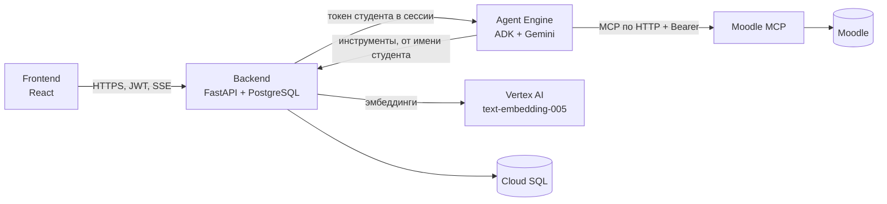

# CampusPulse AI

Умный автономный агент для планирования учёбы: читает задания и лекции студента, раскладывает работу
на подзадачи с цитатами и страницами, находит время в расписании и объясняет каждый свой шаг.
Агент работает на **Gemini + Google ADK** в **Vertex AI Agent Engine**, подключён к внешним системам
через **MCP**, а любое изменение данных происходит только после подтверждения студента.

Проект для хакатона «Build with AI» (GDG Astana): «CampusPulse AI — Smart Autonomous AI Agent with MCP Support».

## Модули

| Модуль | Что это | Стек | Документация |
|---|---|---|---|
| [`frontend/`](frontend) | Веб-интерфейс студента и администратора | React 19, TanStack, Tailwind 4, Vite | [README](frontend/README.md) |
| [`backend/`](backend) | API, база, авторизация, шлюз к агенту, поиск по материалам | FastAPI, PostgreSQL, SQLAlchemy, Alembic | [README](backend/README.md) |
| [`agent/`](agent) | ИИ-агент и скрипт деплоя в Agent Engine | Gemini, Google ADK, Vertex AI | [README](agent/README.md), [деплой](agent/docs/deployment.md) |
| [`mcp/`](mcp) | MCP-сервер Moodle (только чтение) | Python FastMCP | [README](mcp/README.md), [дизайн](mcp/docs/design.md) |

## Как это работает



- **Права.** Backend выпускает агенту короткоживущий токен *студента*: агент видит и меняет только то, что может студент.
- **Предложения вместо действий.** Планы подзадач, инсайты, импорт из Moodle и изменения из чата сначала сохраняются как предложения и проверяются на сервере. Применяются они кнопкой «Apply» или подтверждением.
- **Прозрачность.** Каждый вызов инструмента виден в интерфейсе в реальном времени (Server-Sent Events) и записывается в журнал.
- **RAG.** Лекции режутся на фрагменты и индексируются эмбеддингами; агент и страница Knowledge ищут по смыслу и называют документ и страницу.

## Что можно показать

| Сценарий | Где смотреть |
|---|---|
| Агент с MCP и function calling, шаги рассуждений в реальном времени | чат «Ask CampusPulse», `/activity` |
| Анализ брифа: требования с цитатами и страницами, подзадачи после подтверждения | Upload Assignment |
| RAG по лекциям: вопрос своими словами, «Материалы по теме» в подзадачах | `/knowledge`, карточка подзадачи |
| Правила времени: без пересечений, с дневным лимитом, без прошедшего времени | календарь, план недели |
| Агент предлагает, студент подтверждает: окно «Apply …» | чат |
| Insights от агента с причиной и источниками | `/insights` |
| Импорт заданий из Moodle (предложение → подтверждение) | `/assignments` |
| Календарь, повторяющиеся занятия, CRUD заданий, задач, событий и материалов | интерфейс |
| Анонимные агрегаты факультета | `/admin` |

## Быстрый старт (локально)

Нужны Docker, Node 20+ и Python 3.12.

```bash
# 1. Backend и PostgreSQL
cd backend
cp .env.example .env && cp .env.infrastructure.example .env.infrastructure
docker compose --env-file .env.infrastructure -f compose.infrastructure.yml up -d --wait
docker compose --env-file .env.infrastructure up -d --build
docker compose exec api python -m app.seeds          # демо-данные (необязательно)

# 2. Frontend
cd ../frontend
cp .env.example .env
npm install && npm run dev -- --host 127.0.0.1 --port 5173

# 3. Агент (нужны gcloud и доступ к Vertex AI): serve для локального backend
cd ../agent
gcloud auth application-default login
CAMPUSPULSE_MOODLE_MCP_URL=https://<moodle-mcp>/mcp ./scripts/run_local.sh
```

Откройте http://127.0.0.1:5173. В `backend/.env` для локального агента задайте
`CAMPUSPULSE_AGENT_MODE=adk_server` (подробности в [README агента](agent/README.md)). Без агента остальной интерфейс работает.

## Деплой в Google Cloud

Порядок: **Cloud SQL → Moodle MCP → backend → агент в Agent Engine → frontend**. Команды и ловушки
(права сервисного агента на секреты, пины зависимостей, структура архива) описаны в
[`agent/docs/deployment.md`](agent/docs/deployment.md); у каждого модуля есть свой раздел про Cloud Run.

| Сервис | Откуда |
|---|---|
| `campuspulse-moodle-mcp` | `mcp/` (Cloud Run) |
| `campuspulse-api` | `backend/` (Cloud Run + Cloud SQL, миграции при старте) |
| агент | `agent/deploy/deploy_agent_engine.py` (Agent Engine) |
| `campuspulse-web` | `frontend/` (Cloud Build + Cloud Run) |

## Проверки

```bash
(cd backend  && pytest && ruff check app tests && mypy app)
(cd agent    && pytest && ruff check src tests deploy)
(cd mcp      && pytest && ruff check src tests && mypy src)
(cd frontend && npx tsc --noEmit && npm run test)
```

## Ограничения

- Агент работает по запросу, фонового запуска нет.
- Подключён один MCP-сервер (Moodle, тестовый стенд, общий токен). GitHub и файловый MCP не подключены.
- Загруженные файлы лежат на диске инстанса Cloud Run; текст и поиск остаются в базе, скачивание файла после пересоздания инстанса не работает.
- Нет OCR для сканов, резервных копий базы и ограничения частоты запросов; refresh-токен хранится в `localStorage`.

## Репозиторий

Этот монорепозиторий собран из отдельных репозиториев с сохранением истории (`git subtree`):

| Папка | Исходный репозиторий |
|---|---|
| `backend/` | `campuspulse-backend` |
| `frontend/` | `pixel-true-design-recreation` (связан с Lovable) |
| `agent/` | `campuspulse-agent` |
| `mcp/` | `campuspulse-mcp` |

Изменения можно переносить в оба направления:

```bash
git subtree pull --prefix=frontend https://github.com/DaniyarAbikenov/pixel-true-design-recreation.git main
git subtree push --prefix=frontend https://github.com/DaniyarAbikenov/pixel-true-design-recreation.git <branch>
```

Не переписывайте опубликованную историю `frontend/` (force push, rebase, amend): репозиторий связан с
Lovable, и это удалит историю проекта у него.
