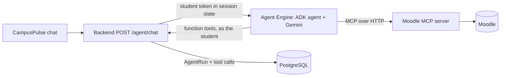

# CampusPulse Agent

The CampusPulse AI agent: **Gemini** orchestrated with **Google ADK**, deployable to
**Vertex AI Agent Engine**. It answers a student's planning questions by choosing tools in a
reasoning loop, and every step is returned to the app so the UI can show it.



## Tools

| Tool | Source | Purpose |
|---|---|---|
| `get_workload`, `list_assignments`, `get_free_time`, `get_schedule` | CampusPulse API | Planner facts: load, assignments, free study windows, what is already in the calendar |
| `list_open_tasks`, `get_study_statistics` | CampusPulse API | Open subtasks; how the student's estimates compare with actual hours |
| `list_campus_events` | CampusPulse API | Ranked events |
| `search_knowledge`, `get_assignment_text` | CampusPulse API | Indexed excerpts and the full brief, with document and page |
| `propose_task_plan` | CampusPulse API | Task breakdown with exact quotes; quotes are verified server-side |
| `propose_insights`, `list_insights` | CampusPulse API | Insights with reasoning and sources; earlier answers are respected |
| `propose_actions` | CampusPulse API | Calendar sessions and activities, tasks, task status, assignment cancellation. Stored as pending: the student confirms each in an **Apply** window |
| `propose_assignment_import` | CampusPulse API | Proposal only; the student approves in the app |
| `moodle_*` (6 tools) | Moodle MCP server | What is on the course site (read-only) |

Everything the agent writes is a *proposal*: the backend validates it against the student's real
data and nothing changes until the student applies it. The agent also receives the current campus
time at the start of each message.

The agent holds no credentials: the backend puts a 60-minute student access token into the ADK
session state, so API rules (roles, ownership) apply exactly as for the student. Moodle text is
treated as untrusted data (see `INSTRUCTION` in `agent.py`).

## Run locally

```bash
python3.12 -m venv .venv && source .venv/bin/activate
pip install -e '.[dev]'
cp .env.example .env        # set GOOGLE_CLOUD_PROJECT or GOOGLE_API_KEY
gcloud auth application-default login          # for Vertex AI
python -m campuspulse_agent.chat "What is due this week?" --token <student access token>
adk api_server src --port 8002                  # or serve it for the backend (mode adk_server)
```

Backend: `CAMPUSPULSE_AGENT_MODE=adk_server`. The easiest local setup is the runner script, which
serves the agent on `127.0.0.1:8002` using your Application Default Credentials and reads the Moodle
MCP key from Secret Manager into the process only:

```bash
CAMPUSPULSE_MOODLE_MCP_URL=https://YOUR-MOODLE-MCP/mcp ./scripts/run_local.sh
```

With the backend in Docker add to its `.env`:
`CAMPUSPULSE_AGENT_MODE=adk_server`, `CAMPUSPULSE_AGENT_ADK_URL=http://host.docker.internal:8002`,
`CAMPUSPULSE_AGENT_ADK_APP=campuspulse_agent` and `CAMPUSPULSE_AGENT_ADK_HOST_HEADER=localhost:8002`
(ADK only accepts local `Host` headers). The Moodle MCP server must be running
(`CAMPUSPULSE_MOODLE_MCP_URL`).

## Deploy to Agent Engine

```bash
pip install -e '.[deploy]'
python deploy/deploy_agent_engine.py --project PROJECT --location us-central1 \
  --staging-bucket gs://PROJECT-campuspulse-staging \
  --backend-url https://BACKEND/api/v1 --moodle-mcp-url https://MOODLE-MCP/mcp
```

Put the printed resource name in the backend as `CAMPUSPULSE_AGENT_RESOURCE` together with
`CAMPUSPULSE_AGENT_MODE=vertex` and the project and location. The backend and the Moodle MCP
server must be reachable from Google Cloud (Cloud Run); see [`docs/deployment.md`](docs/deployment.md).

Update an existing deployment by adding `--update projects/PROJECT_NUMBER/locations/REGION/reasoningEngines/ID`.
The deploy script stages the package at the archive root, pins requirements, passes secrets as
Secret Manager references and keeps `min_instances=0` (scale to zero; the first call after idle can
take a minute or two).

## Checks

```bash
pytest && ruff check src tests deploy
```
