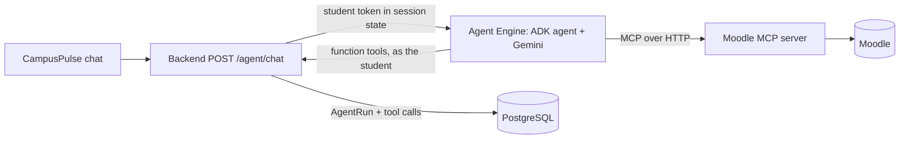

# CampusPulse Agent

The CampusPulse AI agent: **Gemini** orchestrated with **Google ADK**, deployable to
**Vertex AI Agent Engine**. It answers a student's planning questions by choosing tools in a
reasoning loop, and every step is returned to the app so the UI can show it.



## Tools

| Tool | Source | Purpose |
|---|---|---|
| `get_workload`, `list_assignments`, `get_free_time` | CampusPulse API | Planner facts |
| `list_campus_events` | CampusPulse API | Ranked events |
| `search_knowledge` | CampusPulse API | Indexed excerpts with document and page |
| `propose_assignment_import` | CampusPulse API | Proposal only; the student approves in the app |
| `moodle_*` (6 tools) | Moodle MCP server | What is on the course site (read-only) |

The agent holds no credentials: the backend puts a 60-minute student access token into the ADK
session state, so API rules (roles, ownership) apply exactly as for the student. Moodle text is
treated as untrusted data (see `INSTRUCTION` in `agent.py`).

## Run locally

```bash
python3.12 -m venv .venv && source .venv/bin/activate
pip install -e '.[dev]'
cp .env.example .env        # set GOOGLE_CLOUD_PROJECT or GOOGLE_API_KEY
gcloud auth application-default login          # for Vertex AI
python -m campuspulse_agent.chat "What is due this week?" --token <student access token>
adk api_server src --port 8002                  # or serve it for the backend (mode adk_server)
```

Backend: `CAMPUSPULSE_AGENT_MODE=adk_server`. The Moodle MCP server must be running
(`CAMPUSPULSE_MOODLE_MCP_URL`).

## Deploy to Agent Engine

```bash
pip install -e '.[deploy]'
python deploy/deploy_agent_engine.py --project PROJECT --location us-central1 \
  --staging-bucket gs://PROJECT-campuspulse-staging \
  --backend-url https://BACKEND/api/v1 --moodle-mcp-url https://MOODLE-MCP/mcp
```

Put the printed resource name in the backend as `CAMPUSPULSE_AGENT_RESOURCE` together with
`CAMPUSPULSE_AGENT_MODE=vertex` and the project and location. The backend and the Moodle MCP
server must be reachable from Google Cloud (Cloud Run); see [`docs/deployment.md`](docs/deployment.md).

## Checks

```bash
pytest && ruff check src tests deploy
```
