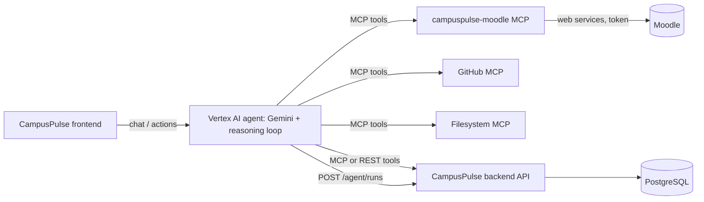

# MCP layer design

## Where MCP sits

- **External systems → MCP servers.** Each external source (Moodle, GitHub, files) is an
  independent MCP server so the agent, not the backend, decides which tool to call.
- **CampusPulse backend stays the source of truth.** The agent writes results (assignments,
  tasks, insights, knowledge fragments) through the backend API with the student's bearer token;
  MCP servers never touch the database.
- **Reasoning trace.** Every agent run is stored through `POST /api/v1/agent/runs` with its ordered
  tool calls, which feeds the Agent Activity page.

## Moodle → CampusPulse mapping

| Moodle | CampusPulse | Notes |
|---|---|---|
| Course (`id`, `shortname`) | `Course` (`code`) | Match on short name; keep the Moodle id in agent state |
| Assignment (`duedate`, `intro`) | `Assignment` (`due_at`, description) | `estimated_hours` is produced by the agent, never copied |
| Submission status | `Assignment.status` | `new`→`todo`, `draft`→`in_progress`, `submitted`/graded→`completed` |
| Calendar event | `ScheduleEvent` / deadline | Only actionable events become tasks |
| Course file | `Document` + `DocumentFragment` | Ingestion pipeline extracts text; `moodle_read_file` handles small text only |

Import is **proposal first**: the agent shows what it found, the student approves, then the agent
calls the backend. This preserves the product rule that generated items need explicit approval.

## Tool design rules

1. Read-only, annotated `readOnlyHint`.
2. Compact normalized output (UTC ISO dates, plain text), not raw Moodle JSON.
3. Narrow inputs with validation (`ge`, `le`) so a confused model cannot request unbounded data.
4. Third-party text is data; never executed or trusted as instructions.
5. One token per deployment now (static token); per-user tokens via `/login/token.php` is the
   upgrade path once real multi-user Moodle login is needed.

## Deployment path (step 3)

- Local/dev: stdio transport.
- Cloud: `streamable-http` transport in a Cloud Run container (see `Dockerfile`), secrets from
  Secret Manager, consumed by the Vertex AI agent as a remote MCP toolset.
- Moodle must be reachable from Cloud Run (public HTTPS); a VPN/localhost stand is not.

## Not in this step

Writing to Moodle, per-user OAuth, PDF/DOCX text extraction, scheduled sync. The extraction
and sync belong to the ingestion pipeline and agent, not to the MCP tools.
