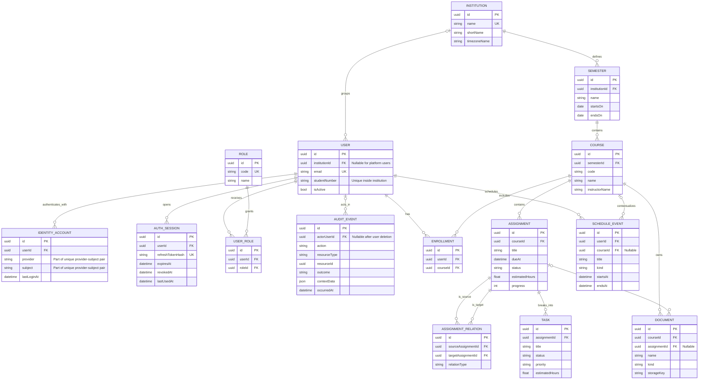

# CampusPulse database ERD

This diagram is the source-of-truth overview for the schema created by the first Alembic migration.
Column-level details and deletion behavior are documented in
[database-schema.md](database-schema.md).

